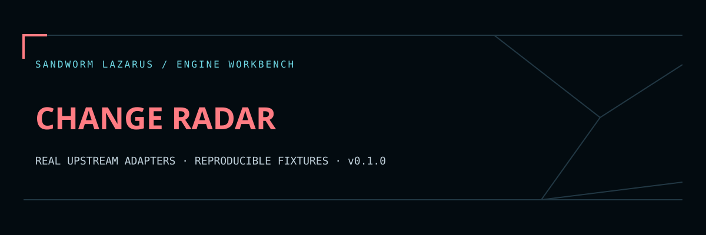

# Sandworm Change Radar



ติดตามหลักฐานการเปลี่ยนแปลงจาก **changedetection.io** ของคุณ แล้วเปรียบเทียบข้อความด้วยกฎที่กำหนดเอง พร้อม SHA-256 และรายงานภาษาไทยที่เปิดในธีม Sandworm ได้

Original, read-only Python integration for changedetection.io API history, snapshot and difference endpoints. The client fetches the latest two recorded text snapshots. Sandworm computes an independently reproducible normalized comparison and records a digest of the upstream diff.

## Quick start — no dependencies

Python 3.12+; standard library only for the client.

```sh
python src/change_radar.py compare examples/before.txt examples/after.txt --fixture --ignore-prefix 'Updated:' > report.json
python scripts/validate.py
```

Default reports contain line ranges, counts and hashes, not raw snapshot lines. Add `--include-diff` only after deciding that the report may include the changed text. This option can disclose secrets present in monitored pages.

## Connect your changedetection.io instance

Use an existing trusted instance. The adapter does not create watches, schedule checks or send notifications. Configure page selectors and monitored URLs in changedetection.io itself.

Set `CHANGEDETECTION_API_KEY` in your environment through your secret manager; do not put it in command arguments or commit it to Git.

```sh
python src/change_radar.py fetch --origin https://monitor.example.org --watch 095be615-a8ad-4c33-8e9c-c7612fbf6c9f > report.json
```

Replace the example origin/UUID with your instance and watch. The origin must be HTTPS with no embedded credentials, path prefix, query or fragment. Reverse proxies under a path prefix are not supported in v1. For a trusted local service only, explicit `--allow-loopback` permits a literal loopback IP such as `http://127.0.0.1:5000`; it does not permit private LAN or cloud metadata addresses.

The client uses four GET requests: history, two exact snapshots, and upstream difference. API origin, key, UUID and server snapshot paths are omitted from reports. A watch digest and snapshot timestamps remain for provenance.

## Normalization and limits

- Unicode NFC, CRLF/CR to LF, trailing whitespace removal. Line order and leading whitespace remain meaningful.
- Up to 16 nonempty **literal line prefixes**, each up to 128 characters, can be ignored. No user regex execution. CSS selectors/HTML filtering belong to the upstream watch configuration.
- 256 KiB UTF-8 per file/API response, 4000 text lines, 2000 history entries. Duplicate JSON keys and invalid timestamps are rejected.
- Fixed-origin HTTPS, TLS verification, all DNS addresses checked before a connection, and connection pinned to a checked address. Redirects and compression are refused; ambient HTTP proxy variables are not used. Socket operations use a 10-second timeout; OS DNS resolution may take longer.
- JSON error messages use fixed codes and omit raw upstream bodies, request URL, input content and API key.

## หน้าอ่านรายงาน / Local viewer

```sh
python -m http.server 8000 --bind 127.0.0.1 --directory web
```

Open `http://127.0.0.1:8000` and import the report or try synthetic data. The viewer handles report JSON only; it does not receive your API key or fetch monitored pages. The separate Python client runs on your own cloud worker. Continuous monitoring needs the upstream changedetection.io service running on a VPS/container; a static page does not provide the scheduler.

## Upstream integration smoke

Optional installation of the pinned upstream package for a reproducible local API-resource check:

```sh
python -m venv .venv
.venv/bin/pip install -r requirements-upstream.txt
.venv/bin/python scripts/upstream_smoke.py
```

The smoke check installs **changedetection.io 0.70.3**, uses its actual datastore, Watch model and authenticated API resource classes, seeds two synthetic history snapshots, and calls them over loopback HTTP with our client. It starts no crawler, scheduler, browser, notification worker, external watch request or AI request. This proves API handler integration, not a full upstream deployment. Separate unit tests use a mock API server to exercise failures. Evidence is in `reports/upstream-live.json`.

## License and development

Original Sandworm code is MIT. changedetection.io is Apache-2.0 and is installed separately. See [THIRD_PARTY_NOTICES.md](THIRD_PARTY_NOTICES.md), [SECURITY.md](SECURITY.md), and [CHANGELOG.md](CHANGELOG.md). This repo is an independent API integration and does not imply affiliation with changedetection.io.

## Sandworm report workspace

The original Sandworm navy/coral theme is included in `web/`. Read [the viewer guide](docs/WEB_VIEWER.md) for local serving, normalized JSON import and export, and [verification scope](docs/BROWSER_QA.md) for the browser QA limit. Run `node --test tests/web.test.cjs` alongside the engine checks above. No worker or scheduler is deployed by opening this static viewer.

The cloud development and upstream smoke checks are reproducible from this repository. A continuously running service needs your own worker/server, authentication, job limits and operational setup. Public source contains synthetic fixtures; local dependencies, secrets, scan targets, model caches and databases are excluded.

Original Sandworm code is MIT-licensed. Upstream engines retain their respective licenses and credit; embedded fonts use OFL with notices in `web/fonts/`.
